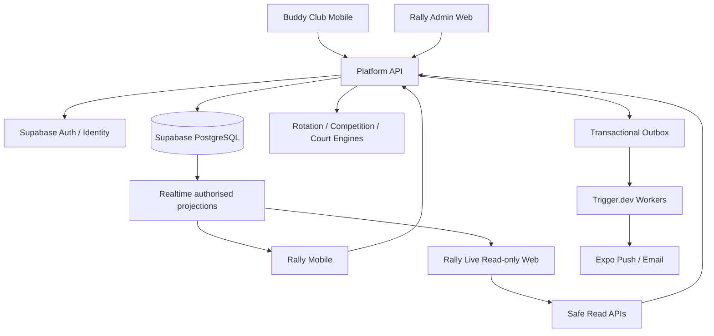
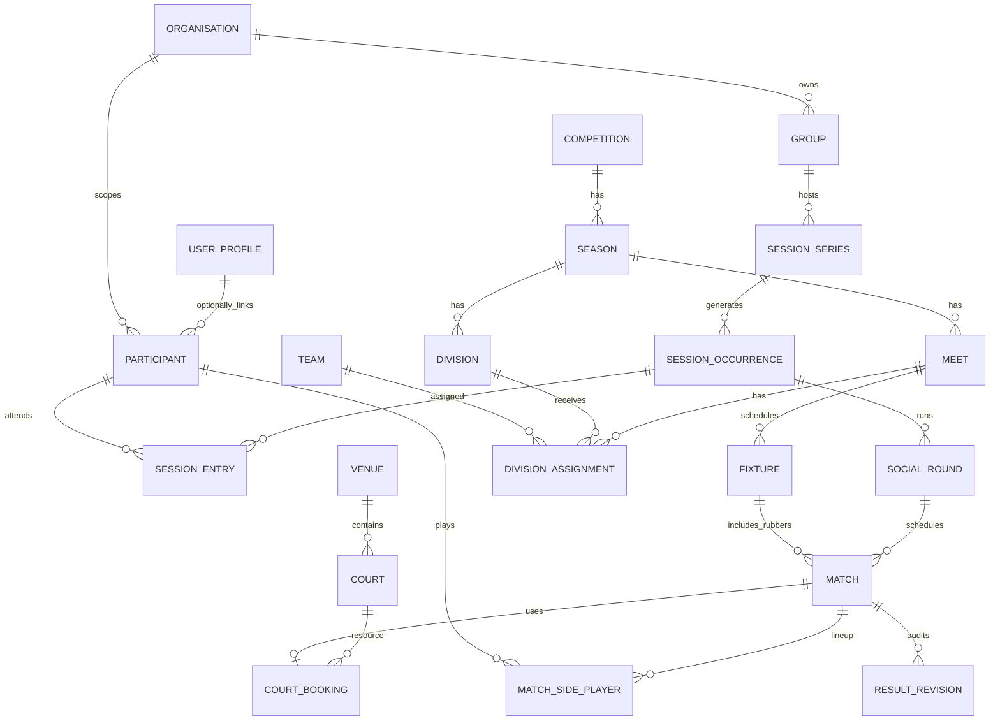

# Rally by Buddy Club — Technical Implementation Specification

**Version:** 1.0 (implementation baseline)  
**Date:** 19 October 2026  
**Status:** Proposed; decisions flagged below require product confirmation  
**Audience:** Claude Code, engineering, product and QA  
**Scope:** Shared Buddy Club platform, Rally social sessions, divisional leagues and tournaments

> **Implementation instruction:** This is a build specification, not permission to deploy production infrastructure. Implement incrementally, with migrations, tests and local emulation. Do not guess missing secrets, DNS names, payment providers or official league scoring policy. Where decisions remain open, use feature flags or clear configuration defaults.

## 1. Product goals and acceptance criteria

One account works in Buddy Club and Rally. A club organiser can create a one-off or recurring social session, accept registered and walk-in guest players, generate fair rotations, manage live changes and allow participants to see read-only court assignments. A competition organiser can run seasons with divisions, repeated regional meets, team-versus-team fixtures, configurable rubbers and scoring, dedicated courts, standings, and controlled promotion/relegation. Tournament formats can share the same match, court and result infrastructure.

**End-to-end reference scenario (must pass automated integration tests):** A league has at least three divisions, four teams in each, two dedicated courts per division for each meet. Every team plays three other teams. Every fixture contains women's doubles, men's doubles, mixed doubles 1 and mixed doubles 2 (four rubbers). Each division produces 6 fixtures and 24 rubbers; each team has 3 fixtures and 12 rubbers. Game target is 21 with win-by-two and point-cap configurable, not assumed. Fixture winner is configurable, including handling 2–2 rubbers. Division ordering is fixture wins then total point differential, with further tie rules configurable. At meet completion, highest team moves up one division, lowest moves down one division (boundary divisions retain top/bottom teams). Organiser previews and approves progression before next meet's assignments are published. Scores, standings and court allocations are retained as immutable historical snapshots/versions.

**Functional acceptance:** (a) guest can be added by organiser with name only; (b) guest gets a participant UUID independent of auth identity; (c) user logs into both apps using same Supabase Auth project; (d) player changes during social play affect future rounds, not committed history; (e) fixed court restrictions cannot be bypassed automatically; (f) no concurrent matches share a player or court; (g) read-only access cannot mutate competition state; (h) all score changes and manual overrides are audited; (i) clients recover correctly after reconnect and duplicate command retries.

## 2. Decisions, assumptions and explicit non-goals

**Recommended baseline:** TypeScript monorepo (pnpm + Turborepo), React Native / Expo apps, Next.js for admin and public display, modular-monolith API with Fastify + Zod + OpenAPI, Supabase PostgreSQL/Auth/Storage/Realtime, Trigger.dev for delayed jobs, SQL migrations and Vitest. NestJS can substitute for Fastify but select one before scaffolding. Prefer direct SQL via a typed query layer (Kysely or equivalent) where transaction boundaries are critical; do not mix ORMs arbitrarily.

**Confirmed business rules:** Shared Buddy Club/Rally identity; organiser-added unregistered players; player read-only schedule; social partner locks, gender-aware preferences and fair sit-outs; configurable match formats; league divisions usually four teams; four named rubbers/fixture; two fixed courts/division per meet; fixture wins then points difference for current reference league; one promotion/one relegation per meet. Every value must remain configurable.

**Open configuration decisions (do not hardcode):** How a 2–2 team fixture is decided (points aggregate, draw, decider); whether a 21-point game requires win-by-two and/or cap; how ties remaining after all ranking criteria are resolved; minimum participant gender/eligibility data and consent; guest claim verification flow; exact season points; score confirmation workflow; match order and concurrency for four rubbers; handling no-show penalties; support of multi-venue meets. Default a disputed/indeterminate result to `needs_review`, never invent a winner.

**Out of MVP:** Payments, rankings integration with governing bodies, geolocation tracking, complex offline multi-writer editing, public social messaging, automated court booking, commercial SaaS billing, double elimination and Swiss pairings. Interfaces may reserve extension points.

## 3. System context and boundaries



The API is the sole write surface for business-critical operations. Front ends may subscribe to authorised, minimal realtime projections. Never let clients directly update match, score, progression, rotation or court allocation tables. A shared Supabase Auth project enables the same credential/account in both apps; individual apps may maintain separate secure local sessions, not shared refresh-token storage.

## 4. Repository structure and coding contracts

```text
apps/{platform-api,buddyclub-mobile,rally-mobile,rally-admin,rally-live}
packages/{api-client,shared-types,rules-schema,auth,rotation-engine,competition-engine,scoring-engine,court-scheduler,ui-mobile,ui-web}
infra/supabase/{migrations,seed,policies,tests}
workers/{notifications,recurring-sessions,projections}
tests/{unit,contract,integration,e2e,fixtures}
docs/{adr,runbooks,api,product}
```

Rules engine packages must have no HTTP/database dependencies; inputs and outputs are serialisable TypeScript values. API modules orchestrate transactions. Use UTC timestamps and IANA venue timezones. Use UUIDs, migration-managed enums/check constraints, Zod validation at API boundary, decimal/integer score types rather than floating point. Every API write must accept `Idempotency-Key` where retries can duplicate operations. Keep an auditable `actor_type`, `actor_id`, `reason`, `correlation_id`, and `ruleset_version`.

## 5. Domain model and entity relationship design

Core separation: an **account** is an authenticated identity; a **participant** is a person who plays, potentially a guest; a **session registration** associates a participant with a particular session occurrence. A **team** is a persistent sporting team; a **lineup** freezes the actual players in a fixture/rubber. A **division** is a lasting competition structure; a **division assignment** associates a team and division with a specific meet.



### 5.1 Tables and essential columns

All table names below are qualified by logical schema; actual migrations should implement constraints and indexes detailed in §5.3.

| Table                              | Required columns (besides PK and timestamps)                                                               | Notes                                                              |
| ---------------------------------- | ---------------------------------------------------------------------------------------------------------- | ------------------------------------------------------------------ |
| `identity.user_profiles`           | `auth_user_id UNIQUE`, display_name, avatar_url, locale                                                    | FK to `auth.users`; no second auth DB                              |
| `identity.participants`            | `organisation_id`, `user_profile_id NULL`, display_name, source, archived_at                               | Guest first-class; user link optional; unique verified link policy |
| `identity.guest_grants`            | `participant_id`, `session_occurrence_id NULL`, token_hash, scopes, expires_at, revoked_at                 | Store hash only; guest claim must be verified                      |
| `community.organisations`          | name, slug, owner_id                                                                                       | Tenant boundary                                                    |
| `community.memberships`            | organisation_id, user_profile_id, role, status                                                             | Unique active membership                                           |
| `community.groups`                 | organisation_id, sport_id, name                                                                            | Buddy Club groups                                                  |
| `community.group_members`          | group_id, participant_id, status                                                                           | Allows guests and registered                                       |
| `facilities.venues`                | organisation_id, name, timezone, address_json                                                              | Venue-local calendar                                               |
| `facilities.courts`                | venue_id, code, sport_ids, zone_id NULL, active                                                            | `UNIQUE(venue_id, code)`                                           |
| `activities.session_series`        | group_id, recurrence_rrule NULL, default_ruleset_id                                                        | One-off if no recurrence                                           |
| `activities.session_occurrences`   | series_id, venue_id, starts_at, ends_at, state, version                                                    | Store actual occurrence                                            |
| `activities.session_entries`       | occurrence_id, participant_id, attendance_status, joined_at, left_at, check_in_at                          | One active entry/person/occurrence                                 |
| `activities.social_rounds`         | occurrence_id, sequence_no, status, starts_at, duration_seconds, revision                                  | Published rounds immutable except explicit amendment               |
| `competition.competitions`         | organisation_id, type, name                                                                                | League/tournament                                                  |
| `competition.seasons`              | competition_id, starts_at, ends_at, ruleset_version_id                                                     | Season rules                                                       |
| `competition.meets`                | season_id, venue_id, starts_at, state, ruleset_snapshot_id, version                                        | Regional meetup                                                    |
| `competition.divisions`            | season_id, ordinal, name                                                                                   | 1 = highest division, configurable                                 |
| `competition.teams`                | organisation_id, name, captain_participant_id NULL                                                         | Persistent team                                                    |
| `competition.team_roster`          | team_id, participant_id, valid_from, valid_to, eligibility_metadata                                        | Effective dates                                                    |
| `competition.division_assignments` | meet_id, division_id, team_id, seed NULL, snapshot_revision                                                | Four per division template                                         |
| `competition.fixtures`             | meet_id, division_id, home_team_id, away_team_id, round_no, status, outcome_policy_version                 | One team-versus-team fixture                                       |
| `matches.matches`                  | fixture_id NULL, social_round_id NULL, rubber_key NULL, state, starts_at, completed_at, ruleset_version_id | Exactly one parent context                                         |
| `matches.match_sides`              | match_id, side_no, team_id NULL                                                                            | Two sides for standard match                                       |
| `matches.match_side_players`       | match_side_id, participant_id, role                                                                        | Snapshot actual lineup                                             |
| `matches.result_revisions`         | match_id, revision, submitted_by, confirmed_by NULL, score_json, result_status, reason                     | Append-only result ledger                                          |
| `facilities.court_pools`           | meet_id NULL, occurrence_id NULL, division_id NULL, policy, exclusive                                      | Owner of constraints                                               |
| `facilities.court_pool_members`    | court_pool_id, court_id                                                                                    | Assigned court whitelist                                           |
| `facilities.court_bookings`        | court_id, match_id, starts_at, ends_at NULL, state                                                         | Protect physical occupancy                                         |
| `platform.rulesets`                | owner_id, kind, schema_version, definition_json, version, immutable_after_use                              | Immutable versioned rules                                          |
| `platform.audit_events`            | entity_type, entity_id, operation, actor_type, actor_id, before_json, after_json, reason, correlation_id   | Append-only                                                        |
| `platform.outbox_events`           | event_type, aggregate_id, payload_json, status, retries, dedupe_key                                        | Transactional outbox                                               |
| `platform.invitation_links`        | scope_type, scope_id, token_hash, permissions, expires_at, max_uses                                        | Never store plaintext token                                        |

### 5.2 Entity invariants

- Every session match belongs to exactly one social round OR fixture, using a CHECK constraint or typed match context.
- A participant may link to a user profile but does not require one. Never merge guest records by matching display name alone.
- A fixture is between two distinct teams belonging to the same division assignment at the target meet.
- Each `(meet_id, division_id, team_id)` must be unique. A team has at most one division assignment per meet.
- A match has exactly two sides for two-sided formats; format-specific lineups validate expected participant count.
- Once published, fixture identity and historical lineups remain traceable; revisions are explicit.
- A court cannot have two active matches at once; a participant cannot have two overlapping active matches.
- Competition events and rounds have optimistic `version` numbers; stale commands return HTTP 409.

### 5.3 Migration/index/constraint requirements

- FK indexes on all relation columns, including `participant_id`, `meet_id`, `division_id`, `fixture_id`, `match_id`, `court_id`, `user_profile_id`.
- `UNIQUE(session_occurrence_id, participant_id)` on session entries; `UNIQUE(meet_id, team_id)` on division assignment; `UNIQUE(fixture_id, rubber_key)` for defined rubber instance; `UNIQUE(match_id, side_no)` on sides.
- Partial unique index for active court occupancy by court, plus transaction-level locking of the court resource. For scheduled overlaps use PostgreSQL `tstzrange` with GiST exclusion constraint if start/end ranges are reliable; for rolling indefinite matches use a separate active occupancy lock per court.
- Enforce participant concurrency via transaction-level participant row advisory/explicit locks and overlap validation; do not rely only on client-side checks.
- Use `JSONB` for versioned rules and score structures but normalised relational match/fixture entities for queries.
- Index `outbox_events(status, created_at)`, `audit_events(entity_type, entity_id, created_at DESC)`, `matches(state, starts_at)`, and realtime projection keys.
- RLS on accessible tables, even if write APIs normally use server-side credentials; separate service privileges from end-user reads. Test cross-organisation access denial.

## 6. Authentication, authorisation and guest lifecycle

**Registered flow:** Both apps redirect to one Supabase Auth issuer (email, Apple, Google supported). API verifies access JWT (`iss`, `aud`, expiry, signature) and looks up role membership in DB. Never infer privileges from app identity or client-provided user IDs. Authenticated users can be roles in multiple organisations.

**Role scopes:** `platform_admin`, `org_admin`, `competition_director`, `session_organiser`, `team_captain`, `participant`, `spectator`. Permissions are resource-scoped (`organisation`, `competition`, `meet`, `session`, `team`); roles are grants, not a single global column.

| Operation                | Org admin | Competition director | Session organiser |      Captain |       Player | Guest view |
| ------------------------ | --------: | -------------------: | ----------------: | -----------: | -----------: | ---------: |
| Configure rules/season   |       Yes |                  Yes |                No |           No |           No |         No |
| Publish meet fixtures    |       Yes |                  Yes |                No |           No |           No |         No |
| Add session guest        |       Yes |          If assigned |               Yes |           No |           No |         No |
| Generate social rotation |       Yes |          If assigned |               Yes |           No |           No |         No |
| Submit team lineup       |       Yes |                  Yes |                No |     Own team |           No |         No |
| Submit result            |       Yes |                  Yes |      Configurable | Configurable | Configurable |         No |
| Approve progression      |       Yes |                  Yes |                No |           No |           No |         No |
| View eligible schedule   |       Yes |                  Yes |               Yes |     Own team |          Own | Own scoped |

**Guest workflow:** Organiser adds participant with display name; optional declared preferences and skill rating. API creates participant and occurrence entry atomically. For view access, create one-use/short-lived signed guest redemption token, store its hash and scope, redeem to a secure guest session credential; do not expose all guest records via unrestricted event QR. Public event QR opens join/check-in landing page, but participant claim requires a secondary organiser-approved proof (PIN, individual link, captain approval). Guest → account linking requires proof and logged consent, with audit trail. Preserve old participant IDs and historic match references; linking only sets a verified `user_profile_id`.

Guest tokens: entropy >=128 bits, short TTL, revoke/rotate, rate limits, no personally sensitive fields in tokens, `Cache-Control: no-store` on private endpoints. Public view-only tournament data is a separate redacted projection.

## 7. API design and contracts

Base URL `/v1`, REST/OpenAPI 3.1, JSON, RFC 7807-ish error bodies `{type,title,status,detail,code,correlationId,fieldErrors?}`. Responses expose `id`, `version`, timestamps. Mutating requests accept `Idempotency-Key` and, for mutable aggregates, `If-Match: <version>`; stale version -> 409 `VERSION_CONFLICT`. Errors include `FORBIDDEN`, `NOT_FOUND`, `RULE_UNSATISFIABLE`, `COURT_CONFLICT`, `PLAYER_CONFLICT`, `INVALID_SCORE`, `UNRESOLVED_TIE`.

### 7.1 Endpoints

| Method / Path                                          | Use                                 | Guard                 |
| ------------------------------------------------------ | ----------------------------------- | --------------------- |
| `GET /me`                                              | Shared profile, memberships, apps   | Signed-in             |
| `POST /organisations/:orgId/participants`              | Add guest or registered participant | Organiser             |
| `POST /participants/:id/claim-intents`                 | Begin verified guest claim          | Guest/registered      |
| `POST /participants/:id/confirm-claim`                 | Link verified guest to account      | Claim proof           |
| `POST /groups` / `GET /groups/:id`                     | Manage/discover groups              | Scoped                |
| `POST /sessions`                                       | Create session series/one-off       | Organiser             |
| `POST /sessions/:id/occurrences`                       | Create occurrence                   | Organiser             |
| `POST /occurrences/:id/check-ins`                      | Check in participant                | Own/captain/organiser |
| `POST /occurrences/:id/participants`                   | Register/add guest mid-flight       | Organiser             |
| `POST /occurrences/:id/participants/:pid/withdraw`     | Mark departure, preserve history    | Organiser             |
| `POST /occurrences/:id/rotations/preview`              | Generate candidate round            | Organiser             |
| `POST /occurrences/:id/rotations/commit`               | Persist result with `If-Match`      | Organiser             |
| `POST /rounds/:id/start` / `POST /rounds/:id/complete` | Manage authoritative timer          | Organiser             |
| `GET /occurrences/:id/my-schedule`                     | Personal read model                 | Own/guest grant       |
| `GET /occurrences/:id/courts`                          | Authorised live court board         | Participant/organiser |
| `POST /competitions` / `POST /seasons`                 | Competition/season setup            | Director              |
| `POST /meets` / `POST /meets/:id/divisions/:id/courts` | Meet & court pools                  | Director              |
| `POST /meets/:id/fixtures/preview`                     | Generate eligible fixture graph     | Director              |
| `POST /meets/:id/fixtures/commit`                      | Publish fixtures                    | Director              |
| `POST /matches/:id/call` / `start` / `complete`        | Court operations                    | Organiser             |
| `POST /matches/:id/results`                            | Submit result revision              | Enabled role          |
| `POST /matches/:id/results/:revision/confirm`          | Verify result                       | Authorised confirmer  |
| `GET /meets/:id/standings`                             | Standings + rules version           | Allowed audience      |
| `POST /meets/:id/progression/preview`                  | Compute movement                    | Director              |
| `POST /meets/:id/progression/commit`                   | Approve next meet assignment        | Director              |
| `POST /guest-access/redeem`                            | Redeem scoped link/QR credential    | Limited               |
| `GET /public/events/:slug/board`                       | Redacted public schedule            | Public if published   |

### 7.2 Representative request and response

```json
// POST /v1/occurrences/{occurrenceId}/rotations/preview
{
  "algorithm": "social_doubles_v1",
  "targetRoundSequence": 5,
  "rulesetVersionId": "uuid",
  "includeParticipantIds": ["uuid-a", "uuid-b"],
  "lockedPairs": [{ "participantA": "uuid-a", "participantB": "uuid-b", "mode": "hard" }]
}
```

```json
// 200 OK; example shape
{
  "previewId": "uuid",
  "sourceVersion": 17,
  "assignments": [{ "courtId": "uuid", "sideA": ["p1", "p2"], "sideB": ["p3", "p4"] }],
  "restingParticipantIds": ["p9", "p10"],
  "quality": { "restVariance": 0.35, "repeatPartnerPenalty": 0 },
  "warnings": [],
  "expiresAt": "2026-10-19T10:05:00Z"
}
```

`commit` accepts only a persisted preview ID and the current occurrence version. API revalidates attendance, courts and constraints inside transaction before saving. Do not trust a client-submitted arbitrary list of assignments. Read models should show `confirmed` versus `provisional` assignments clearly.

## 8. Rotation engine — interface and algorithm

```ts
interface RotationInput {
  occurrenceId: string;
  sequence: number;
  seed: string;
  format: 'singles' | 'doubles';
  courts: { id: string; available: boolean }[];
  participants: {
    id: string;
    available: boolean;
    skill?: number;
    genderPreference?: string;
    minutesPlayed: number;
    restCount: number;
    consecutiveRests: number;
    partnerHistory: Record<string, number>;
    opponentHistory: Record<string, number>;
  }[];
  pairLocks: { a: string; b: string; kind: 'hard' | 'soft'; untilRound?: number }[];
  rules: {
    genderMode: string;
    maxConsecutiveRests?: number;
    weights: { rest: number; minutes: number; partners: number; opponents: number; skill: number };
  };
}
interface RotationResult {
  assignments: { courtId: string; teams: string[][] }[];
  rests: string[];
  warnings: { code: string; detail: string }[];
  metrics: Record<string, number>;
  algorithmVersion: string;
}
```

Algorithm v1: select eligible active players; validate hard locks and mathematically achievable team sizes; model hard-locked pairs as units; determine playable slots (`courts * players_per_court`) and resting count; rank rest allocations by weighted fairness (rest count, consecutive rests, actual minutes) but never penalise someone for pre-arrival rounds; generate a bounded deterministic candidate set of pairings/opponents; reject gender/availability/lock conflicts; score repeats, skill imbalance and fairness; return best candidate and explicit warnings. If hard rules cannot be met, return unsatisfiable explanations, not silent rule relaxation. Consider CP-SAT/constraint solver if heuristic quality is insufficient, while keeping interface stable.

Mid-flight: previous rounds and score history immutable. Withdrawal marks effective time; current match requires organiser choice (`finish`, `substitute`, `forfeit`, `cancel`); next-round preview regenerated against new occurrence version. Pair-lock modes: hard/session, timed rounds, soft preference. Gender matching should be opt-in and support missing/unset data without presuming gender identity; strict format eligibility configured by competition organiser with appropriate policies.

## 9. Competition and fixture engines

### 9.1 Fixture generation

`buildRoundRobin(teams, seed)` yields unique unordered pairs exactly once; for four teams output 6 fixtures in 3 rounds. `expandFixture(fixture, rubberTemplate)` creates four named rubber matches. Participant lineups may be unknown until captains submit them; match eligibility must be validated before court call. Preserve `fixture_id` and `rubber_key` for idempotent generation. Multiple divisions can generate in parallel but court constraints span the entire venue.

### 9.2 Scoring

Rule schema contains `targetPoints`, `winBy`, `cap`, `setsPerRubber`, `allowDraw`, `forfeitPolicy`, `rubberTemplate`. Score validator computes rubber winner from submitted points and rules, and differentiates `submitted`, `confirmed`, `disputed`, `void`. A 21-point game is _not assumed_ to require win by two unless configured. Fixture winner policy is separate: `most_rubbers`, optional tie break by `aggregate_points`, `draw_allowed` or `decider`. If tied with no configured tie resolution, set fixture `needs_review`.

### 9.3 Standings and progression

Input: all _confirmed_ match results for meet, fixture outcome rules and ordered standing criteria. Configurable criteria include `fixture_wins`, `points_difference`, `rubbers_won`, `head_to_head`, `points_scored`, `fixture_draws`, `disciplinary_points` (future). Compute points difference by sum of points scored minus conceded across confirmed rubbers, not by fixture margin. Ranking applies criteria lexicographically and handles head-to-head mini-tables carefully; if still tied, show unresolved tie requiring documented director decision or configured deterministic final criterion. Never use alphabetical team name to award promotion unless explicitly approved as an administrative fallback.

For reference league: primary fixture wins, secondary total points difference; top 1 rises, bottom 1 falls at each meet, with top/bottom division boundaries handled. Preview progression as a matrix from current meet division assignments to next meet assignments; validate no duplicates, full division capacity, withdrawals/new teams and manual exceptions; commit after director approval, preserving input rankings/ruleset and before/after snapshots.

### 9.4 Court allocation

Court-pool policy supports `fixed_division`, `fixed_team`, `fixed_zone`, `dynamic`, `preferred`, `manual`. `fixed_division` is a hard whitelist tied to the _meet_, not permanently to the division: e.g., division 3 may use courts 5 and 6 at venue A but courts 11 and 12 at venue B. Exclusive court pools prevent two divisions claiming the same courts simultaneously. A free court can call only an eligible match in its pool; if no eligible match exists it stays idle. Manual override requires reason, auditable approval and updates to affected players. Match dependencies and player overlap are checked at assignment and match start.

## 10. Realtime, offline and notifications

Server is timer authority (`started_at`, `duration_seconds`, `paused_total_seconds`, `version`); clients render countdown from time sync rather than a permanently running organiser phone timer. Persisted state events: `session.round_published`, `session.round_started`, `match.court_assigned`, `match.result_confirmed`, `meet.standings_updated`, `meet.progression_published`, `participant.withdrawn`. Realtime payloads contain identifiers/revision and safe minimal read fields; clients refetch on reconnect, missed revision or rejected optimistic update.

Outbox event transactionally committed with match change. Worker retries idempotently, with backoff and dead-letter workflow; notification template renders only authorised information. Push court calls only for confirmed allocations; provisional assignments should not issue actionable push alerts. Offline MVP = cached read-only schedule, locally calculated timer and network status; organiser changes require online connection. Never promise offline multi-device authoritative writes in MVP.

## 11. Security, RLS and privacy

Trust boundary: mobile/web input untrusted, JWT verified API-side, scoped business authorisation per resource, tenant ID derived from authenticated membership not request body. Public and guest views use server-filtered projections (avoid broad SELECT policies). Service credential stays server-only; no service role in Expo or browser bundles. RLS tests: member of club A denied club B membership, results under embargo denied spectator, guest can only access assigned event scope, player cannot publish results when policy disallows, stale captain cannot modify former team. Storage policies guard avatars/venue maps based on visibility.

Security checklist: input validation; CSRF protection for cookie-backed web sessions; OAuth PKCE and deep-link allowlists; token rotation and hashing; rate limiting for QR redeem, account claim and invitation; audit log for court override/score correction; data minimisation; guest retention policy; account deletion/anonymisation without altering historical aggregate results; backups/PITR and restore rehearsal; error telemetry without secrets/PII; privacy notice for optional demographic matching data.

## 12. Events, commands and consistency

All state-changing API handlers follow: authenticate -> authorise -> parse -> load aggregate version -> lock relevant rows -> validate hard invariants -> mutate -> audit -> outbox -> commit -> respond. Use command IDs for deduplication and domain events for async projections. Critical consistency is transactional for match start/court occupancy/result/fixture outcome, eventual for standings projections and push notifications; on publication of progression, recompute from committed results in same transaction or pin a hash/revision of inputs.

Examples: concurrent court claim (one succeeds, second gets 409); two simultaneous score submissions produce revision/conflict handling; retry after timeout with same idempotency key returns prior result; organiser A withdraws player while organiser B commits round preview -> preview rejected with stale revision.

## 13. Front-end screen inventory

**Buddy Club mobile:** shared sign-in/onboarding, profile, groups, discover/join session, organisation settings, Rally event deep link.

**Rally mobile — player:** session list, join/check-in, My Game, provisional My Schedule, confirmed Court / Opponents, Venue Map, fixtures, league table, results, push preferences, guest redemption.

**Rally mobile — organiser:** create session, player roster/guests, rule presets, pair locks, live round timer, rotation preview/commit, substitutions, venue court board, score entry (if authorised).

**Rally admin web:** competition/season creation, rule builder, teams/rosters, divisions, meet generator, dedicated court pools, lineup admin, draw/fixtures, results & disputes, standings and progression preview/approval, audit history, CSV import/export.

**Rally live web:** read-only public/guest QR view, court board, now playing/next up, redacted standings, venue map. Do not show private phone numbers or unapproved participant profile data.

Each screen has loading/error/empty/offline/conflict states; screen accessibility supports large dynamic text, accessible colour contrast, non-colour status indicators and push deep-link targets.

## 14. Implementation phases and deliverables

### Phase 0 — Foundations

Create monorepo, CI, lint/typecheck/test standards, Supabase local setup, platform API skeleton, OpenAPI generation, migrations pipeline, seed data, permission middleware, correlation IDs and baseline observability. **Exit:** CI green, migrated DB locally, protected `/me` endpoint and generated client.

### Phase 1 — Shared identity and guest participants

Implement profiles, organisations, groups, venue/courts, memberships/roles, guest participant lifecycle, secure guest access, deep-links and basic Buddy Club/Rally mobile shells. **Exit:** same registered account authenticates in both; guest added without login and can view only their authorised assignment; cross-tenant negative tests pass.

### Phase 2 — Social rotation MVP

Session series/occurrences, check-in, rulesets, pair locks, deterministic rotation engine, fair sit-outs, preview/commit, authoritative round timer, live player read models, mid-flight changes and push notifications. **Exit:** 11 players / 2 courts scenario distributes rests fairly across 4+ rounds; withdrawal preserves prior rounds; two organisers cannot commit divergent rounds.

### Phase 3 — Reference divisional league

Teams/rosters, seasons, meets, four-team round robin, four rubber templates, fixture scoring, ranking criteria, dedicated court pools, captain lineups, guest team members, progression preview/commit, admin web. **Exit:** seed three divisions and 12 teams, 72 rubbers total, correct fixed-court behaviour, standings accurate, promotion/relegation approved with audit history. Include real example: New Forest +71 and NTA Basingstoke +15 with 2 fixture wins each, New Forest ranks above NTA.

### Phase 4 — General tournaments and operations

Pools into knockout, seeding, event QR registration, result disputes, public venue screens, multi-organiser workflows, reports, CSV import/export, resilience/load tests. **Exit:** 32-team group-to-knockout tournament runs with no duplicate court/player allocations and safe read-only public view.

## 15. Test strategy and minimum fixtures

**Unit:** pure rotation fairness metrics, locked pair never split, strict gender constraints unsatisfiable, same player cannot be on two courts, round robin unique pairs, winner validation for 21-point scoring variants, 2–2 fixture outcome branch, standings lexicographic tie resolution, division boundaries and promotion mapping.

**Property-based:** for random 4–40 player social pools and 1–10 courts, output has no duplicate player within a round, all assigned players eligible, no duplicate court; for random team counts, round robin has `n(n-1)/2` distinct fixtures; deterministic replay yields identical output for same seed/input/version.

**Integration:** PostgreSQL RLS denied access across tenants; concurrent court allocations; idempotent retries; published rules snapshot unchanged when template edited; guest claim does not rewrite match history; score amendment reprojects standings; stale progression revision denied; invite token replay/revocation handling.

**E2E:** organiser adds a walk-in, generates round, player QR redeems and sees court, organiser withdraws player, new round updates; director configures multiple divisions, assigns exclusive courts, completes all fixtures, previews then commits progression; spectator sees redacted read-only results.

**Performance targets (starting SLOs, adjust after measurement):** API p95 reads <300 ms under representative load, simple state-changing commands <500 ms, social rotation preview <1 s for <=40 players/10 courts, realtime update perceived within ~2 s in normal network, no duplicate outbox notifications despite retries. Test rather than assert unmeasured compliance.

## 16. Development guidance for Claude Code

**Do not implement the entire specification in one pass.** Complete Phases 0 → 1 → 2 → 3 → 4 behind tests and change review. For each phase: produce concise plan; create migrations first; implement domain types and pure rules engine tests; write API commands/read models; generate API clients; create minimum screens; run unit/integration tests and local demo; report changes and unresolved decisions. Never run migrations against production without explicit approval.

**Suggested first Claude Code prompt:**

```text
Read RALLY_TECHNICAL_SPEC.md in full. Implement Phase 0 only.
Use pnpm + Turborepo, TypeScript, a Fastify API, Supabase local dev,
Zod and OpenAPI, Vitest, and the documented app/package layout.
Before writing code, provide ADRs for auth/session sharing, DB query layer,
RLS/read models, and API deployment. Then create working scaffolding,
initial Supabase migrations for identity/organisation/participants,
minimal `/v1/me` API and contract tests, CI, and README.
Do not scaffold the full application or fabricate production credentials.
Show commands to run locally and passing test output.
```

**Phase-by-phase Claude prompts:** Keep individual phases in `docs/implementation/phase-N.md` with scope, DB migrations, API routes, acceptance tests, rollout and rollback. Stop and ask when an unresolved league policy affects correct competition outcomes.

## 17. Architectural decision register

| ID      | Decision                                                     | Status                      |
| ------- | ------------------------------------------------------------ | --------------------------- |
| ADR-001 | Shared Supabase Auth project for Buddy Club and Rally        | Proposed — recommended      |
| ADR-002 | Single modular monolith API for privileged writes            | Proposed — recommended      |
| ADR-003 | Participants independent of account identities               | Required                    |
| ADR-004 | Meet-specific immutable rulesets                             | Required                    |
| ADR-005 | Fixture/match vs court scheduling separated                  | Required                    |
| ADR-006 | Transactional outbox + realtime read projection              | Proposed — recommended      |
| ADR-007 | Fastify vs NestJS; query library                             | Decide in Phase 0           |
| ADR-008 | Guest redemption proof and claim verification                | Decide before guest release |
| ADR-009 | 2–2 fixture outcome and score cap/win-by-two                 | Product confirmation        |
| ADR-010 | Operational hosting/region, data retention and backup policy | Decide before production    |

## 18. Definition of Done

No phase is complete unless: migrations are repeatable and reversible where feasible; contract and auth tests pass; sensitive data has tenant/role isolation; audit events exist for privileged state changes; representative mobile and web workflows work locally; API docs generated; validation errors are actionable; README gives reproducible commands; CI passes; unresolved assumptions are documented instead of silently decided.
